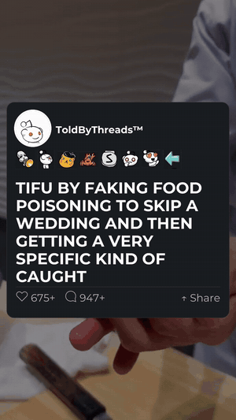

# AI Shorts Generator

An end-to-end Python pipeline that writes, narrates, edits and uploads
vertical short-form story videos (YouTube Shorts / TikTok / Reels) with no
manual steps. It ran unattended on a daily schedule for a live YouTube channel.

<p align="center">
  
  <br><em>Opening of a video produced end to end by the pipeline</em>
</p>

```
Claude (story) -> Claude (script + hook) -> Edge TTS -> Whisper alignment
   -> MoviePy render (post card, word-synced captions, music, outro)
   -> thumbnail -> YouTube Data API upload -> SQLite job tracking
```

## Highlights

- **LLM content generation**: `story_generator.py` uses Claude to write original
  Reddit-style stories; `processor.py` tightens them into a ~60-90s script with a
  hook and a comment-prompt CTA. `llm.py` centralizes model IDs, token budgets and
  refusal handling.
- **Word-accurate captions**: `tts.py` generates narration with Edge TTS, then
  runs Whisper on the result to get per-word timestamps (falls back to
  syllable-weighted estimation if Whisper isn't installed).
- **Programmatic video editing**: `video_builder.py` (MoviePy 2) composites a
  looping background, an animated Reddit-style intro card (`post_card.py`),
  pop-in captions, background music (`music.py`), SFX and a branded outro.
- **Automated publishing**: `poster.py` handles YouTube OAuth (token refresh,
  resumable upload, custom thumbnail) with TikTok / Instagram Graph API paths.
- **State and idempotency**: `db.py` (SQLite) records every job's status
  (`scripted -> tts_done -> rendered -> posted / failed`), per-platform post
  results and processed source IDs so nothing is reused.
- **Scheduling**: `python main.py --schedule` (APScheduler) or
  `run_scheduled.bat` for Windows Task Scheduler.
- **Alternate source**: `scraper.py` pulls high-engagement posts from Reddit's public
  JSON API (engagement scoring, time-window fallback, dedupe) instead of
  generated stories; see `test_video_askreddit.py`.

## Tech stack

Python, Anthropic Claude API, Edge TTS, OpenAI Whisper, MoviePy, Pillow,
NumPy, SQLite, APScheduler, YouTube Data API v3 / OAuth 2.0

## Project layout

| File | Role |
|---|---|
| `main.py` | Orchestrator: generate, process, TTS, render, upload |
| `story_generator.py`, `processor.py`, `llm.py` | Claude prompts and calls |
| `scraper.py` | Optional Reddit source |
| `tts.py` | Narration and word timestamps |
| `video_builder.py`, `post_card.py`, `music.py`, `outro.py`, `thumbnail.py`, `screenshot.py` | Rendering |
| `poster.py` | Platform uploads |
| `db.py`, `db_updates.py`, `db_posting_helpers.py` | SQLite schema and helpers |
| `test_*.py` | Single-video and auth smoke tests |

## Setup

Requires Python 3.10+ and [FFmpeg](https://ffmpeg.org/download.html) on your PATH.

```bash
python -m venv venv
venv\Scripts\activate          # macOS/Linux: source venv/bin/activate
pip install -r requirements.txt
cp .env.example .env           # then fill in your keys
```

1. Add media to `assets/`; see [assets/README.md](assets/README.md).
2. For uploads, create an OAuth "Desktop app" client in Google Cloud with the
   YouTube Data API v3 enabled, save it as `youtube_secrets.json`, then run
   `python test_youtube_auth.py` once to authorize.

## Running

```bash
python main.py                  # one run
python main.py --max-posts 3    # several videos in one run
python main.py --schedule       # 4 PM + 7 PM daily
python test_video.py            # render one video from a Reddit URL, no upload
```

Output lands in `output/` (audio, timestamps, videos, thumbnails).

## Notes

- AI-generated content: YouTube and TikTok require disclosure; the uploader sets
  this in the video metadata and description.
- All secrets live in `.env` and `youtube_*.json`, which are git-ignored.

## License

Code is released under the [MIT License](LICENSE). Media assets are not included.
